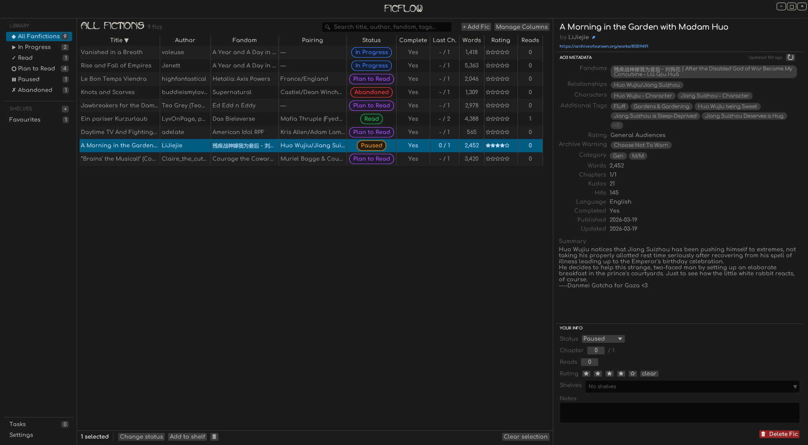

# Ficflow

Ficflow is a software designed to help you track your fanfiction reading list and organize them the way you want.



## Why Ficflow?

I felt like there was a lack of ways to manage my AO3 reading list (other than having hundreds of tabs opened on my phone or saving the links in my notes), so I decided to work on a solution! It's also my first time making a project in Rust, so if you have any criticism about my approach, feel free to open an issue and teach me!

## Installation

Prebuilt binaries for every release are available on the [Releases page](https://github.com/yvesmotteux/Ficflow/releases/latest). Ficflow is a single binary: run it with no arguments to launch the GUI, or pass a subcommand to use the CLI.

> **Heads-up:** Ficflow is developed and tested on Linux. The Windows and macOS builds compile and run, but I haven't been able to exercise them under real-world use. If you hit a bug on either platform, please [open an issue](https://github.com/yvesmotteux/Ficflow/issues) — reports are very welcome.

### Arch Linux (AUR)

```sh
yay -S ficflow-bin
# or with paru
paru -S ficflow-bin
```

### Linux (any distribution — AppImage, recommended)

A portable [AppImage](https://appimage.org) bundle is published with every release. Runs on most desktop Linux distributions (anything newer than mid-2022) without installation:

```sh
curl -L -o Ficflow.AppImage https://github.com/yvesmotteux/Ficflow/releases/latest/download/Ficflow-x86_64.AppImage
chmod +x Ficflow.AppImage
./Ficflow.AppImage
```

### Linux (manual binary install)

If you'd rather drop the raw binary into `/usr/local/bin/` yourself:

```sh
curl -L -o ficflow https://github.com/yvesmotteux/Ficflow/releases/latest/download/ficflow-linux-amd64
chmod +x ficflow
sudo mv ficflow /usr/local/bin/
```

### macOS

Apple Silicon (M1/M2/M3+) only. Intel Macs aren't shipped as prebuilt binaries — build from source if you need Intel.

```sh
curl -L -o ficflow https://github.com/yvesmotteux/Ficflow/releases/latest/download/ficflow-macos-arm64
chmod +x ficflow
sudo mv ficflow /usr/local/bin/
```

The binary is unsigned, so the first launch will be blocked by Gatekeeper. Either right-click the binary in Finder and choose **Open**, or remove the quarantine flag once:

```sh
xattr -d com.apple.quarantine /usr/local/bin/ficflow
```

### Windows

1. Download `ficflow-windows-amd64.exe` from the [Release page](https://github.com/yvesmotteux/Ficflow/releases/latest).
2. (Optional) Move it to a directory on your `PATH` so you can run it from any terminal.
3. Double-click to launch the GUI, or invoke it from PowerShell / cmd with arguments for the CLI.

SmartScreen may warn the first time; click **More info → Run anyway**.

### Build from source

Requires a stable Rust toolchain (≥ 1.75 recommended).

```sh
git clone https://github.com/yvesmotteux/Ficflow.git
cd Ficflow
cargo build --release
./target/release/ficflow
```

## Features (Planned, the order is approximate)

- [ ] when logged in, regularly sync the AO3 "Marked for Later" list into Ficflow
- [ ] opt-in option to back up the epub files of all fanfictions added to the database
- [ ] detect when a fanfic was removed from AO3 and tag it specially / send a message to the inbox. If epub dl optin, explicitly offer access to the fic
- [ ] add the ability to follow a user (new fics from followed users land in the inbox)
- [ ] Add a "search" system based on tags, with an option to filter out fics already catalogued. New fics land in the inbox. Actually would be more like "subscription" window with the ability to subscribe to users, collections, series, or any kind of AO3 search (tags+pairings+fandoms+warnings+complete+crossovers+.....). Series already in the library should be refreshed regularly too: new parts land in the inbox, and the series info (title, description, word count, complete…) stays up to date
- [ ] Setting to make it start in the background on computer start-up, and stay on background when closing (opt-in, different settings or same? SHould add a proper, cleaner "quit" option if so)
- [ ] column management per tab (include per shelf or not?)
- [ ] Create a mobile phone app

## Contributing

Any feedback or contributions are welcome! If you have ideas, suggestions, or improvements, feel free to open an issue or submit a pull request.

